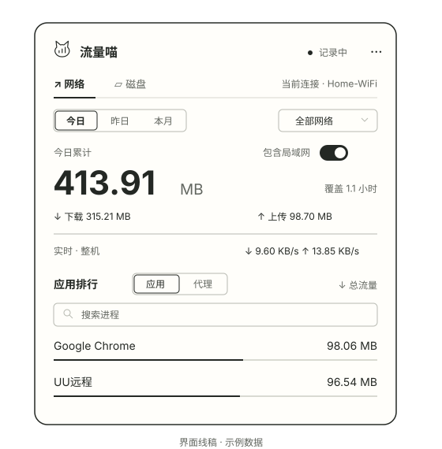

# 流量喵 · FlowCat


一个原生 macOS 菜单栏流量工具。点击菜单栏，查看整机流量和进程排行，帮助了解手机热点、远程桌面与日常开发的流量消耗。

**应用体积约 1.5 MB · macOS 13+ · Apple Silicon · MIT**

[下载最新版](https://github.com/tab16360/flowcat/releases/latest/download/FlowCat-arm64.zip) · [介绍站点](https://tab16360.github.io/flowcat/) · [使用说明](docs/guide.md) · [更新记录](CHANGELOG.md)



*上图为界面示意，使用示例数据，并非实际采集截图。*

## 能做什么

| 功能 | 说明 |
| --- | --- |
| 菜单栏显示 | 默认显示猫咪图标和网速；右键或“更多”可隐藏网速，设置自动保存；点击展开统计 |
| 今日／昨日／本月 | 查看各时段整机收发总量与采集覆盖时间 |
| 应用／代理排行 | 已识别的代理、VPN 单列；合并可识别的 App 辅助进程；支持搜索与总量、下载、上传排序 |
| 互联网／局域网 | 默认查看互联网；全部流量使用网卡计数；分项按连接估算，便于区分网络备份与上网传输；仅覆盖升级后的采样 |
| 按 Wi-Fi 筛选 | 使用真实 SSID；不能识别或拒绝权限时仅显示全部网络 |
| 本地记录 | JSON 持久化，可导出 CSV；无需账号、不上传数据、不记录通信内容 |
| 右键快捷控制 | 菜单栏图标右键或 Control 点击，打开面板、暂停／继续、登录启动、导出和退出 |
| 持续运行 | 暂停／继续、登录启动、睡眠恢复后重新建立计数基线 |


## 小巧的原生应用

**应用体积仅约 1.5 MB。** 无需安装 Node、浏览器内核或第三方运行环境，下载解压即可使用。这里指 `.app` 安装体积，不包含本地历史文件。

每 10 秒采样，每分钟保存；统计面板与图标按需加载。历史保存在本机，无需账号，不上传通信内容。

## 安装

网站与下载链接直接获取最新安装 ZIP。1.4.0 起，应用右键或“更多”菜单的“检查更新”可选择“安装并重启”：自动下载、校验、替换并重启，保留历史和设置，失败时恢复旧版。下载可取消；安装位置需可写。1.3.x 需先手动安装一次 1.4.0。检查由你手动触发，访问 GitHub，不发送统计记录。

1. 点击 [下载安装包](https://github.com/tab16360/flowcat/releases/latest/download/FlowCat-arm64.zip) 下载 `FlowCat-版本-arm64.zip`。
2. 解压，将 `流量喵.app` 拖入“应用程序”，双击启动。
3. 点击菜单栏图标。首次运行约 10 秒用于建立基线；“更多”菜单可设置登录启动。
4. 无法读取 Wi-Fi 名称时会请求系统定位权限。你可以拒绝，统计仍在全部网络下进行，应用不会请求位置坐标。

应用当前为临时签名、未公证。macOS 可能阻止首次打开；确认来源后按系统设置“隐私与安全性”的提示允许打开，不需要关闭系统安全功能。升级前退出旧版，再替换应用。

历史保存在 `~/Library/Application Support/流量账本/ledger.json`。替换应用不会删除历史，卸载时先关闭登录启动并退出。详细说明见 [使用指南](docs/guide.md)。

## 怎样理解数字

**整机总量**使用 `en*` 物理网络接口计数，排除回环与 VPN 虚拟接口。包含局域网和协议开销；多网卡活动会汇总，不能替代运营商账单。

**互联网／局域网**按物理接口上的连接对端及当前子网估算，排除本地回环和虚拟接口；不会把未知对端或 VPN 内层连接硬归类。分项可能遗漏短时连接、协议开销，不能与网卡总量相加；历史不能补分。连接地址只用于内存中的采样分类，不保存在历史中。

**应用／代理排行**来自 `nettop`，默认展示应用，已识别的代理和 VPN 在单独列表展示。此分类仅影响展示，不扣减或重分配历史字节。代理、VPN 可能包含其他进程转发的相同流量，因此不要把排行各行相加作为整机总量。

仅统计应用运行且未暂停的时段，不能恢复过去的流量。10 秒采样，每分钟保存；短时进程、睡眠、网络切换和计数器重置可能漏计。网络切换间隔跳过，多物理网卡同时活跃仅计入全部网络。

## 从源码构建

需要 macOS 13+ 和 Xcode Command Line Tools，不需要 Node、pnpm 或第三方库。

```sh
git clone https://github.com/tab16360/flowcat.git
cd flowcat
bash scripts/test.sh
bash scripts/build.sh
open build/流量喵.app
```

构建默认 arm64；可使用 `ARCH=x86_64 bash scripts/build.sh` 尝试 Intel 构建，当前未进行 Intel 运行验收。创建发布包：

```sh
bash scripts/package.sh
# 输出 dist/FlowCat-1.4.0-arm64.zip 及其 SHA-256
```

应用图标与菜单栏猫咪共用 `Sources/BrandIcon.swift` 中的矢量造型。修改后运行 `bash scripts/icons.sh` 重新生成应用图标及站点预览。

## 项目结构

```text
Sources/       SwiftUI 界面、采样、SSID 识别与统计核心
Tests/         核心统计回归检查
scripts/       构建、检查、打包和发布
Info.plist     应用身份、版本与权限说明
docs/          静态介绍站点、图示与使用指南
.github/       CI、GitHub Pages 与 tag Release 工作流
```

本地预览介绍页：`python3 -m http.server 8080 --directory docs`，访问 `http://localhost:8080`。页面不使用第三方 CDN、跟踪器或外部字体。

## 发布与维护

CI 检查核心统计并生成安装包。`main` 上的站点更新由 GitHub Pages 工作流发布。发布前更新 `Info.plist`、`CHANGELOG.md` 和 `RELEASE_NOTES.md`，然后推送与版本一致的 `vX.Y.Z` 标签；Release 工作流验证、打包并上传 ZIP 与校验文件。

完整发布步骤见 [发布指南](docs/releasing.md)，参与开发见 [CONTRIBUTING](CONTRIBUTING.md)。

## 验证状态

1.4.0 本机构建与签名检查通过，93 项核心与更新检查通过。本机采样进程已运行并用于资源观察；图形自动化未获该应用访问权限，完整菜单栏交互、权限弹窗和面板开关循环尚未验收。图示不能替代运行测试。

采用 [MIT 许可证](LICENSE)。
