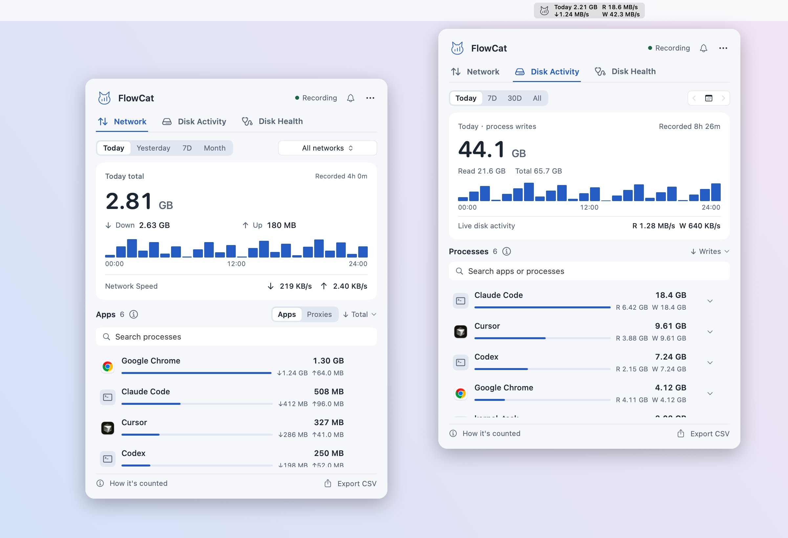
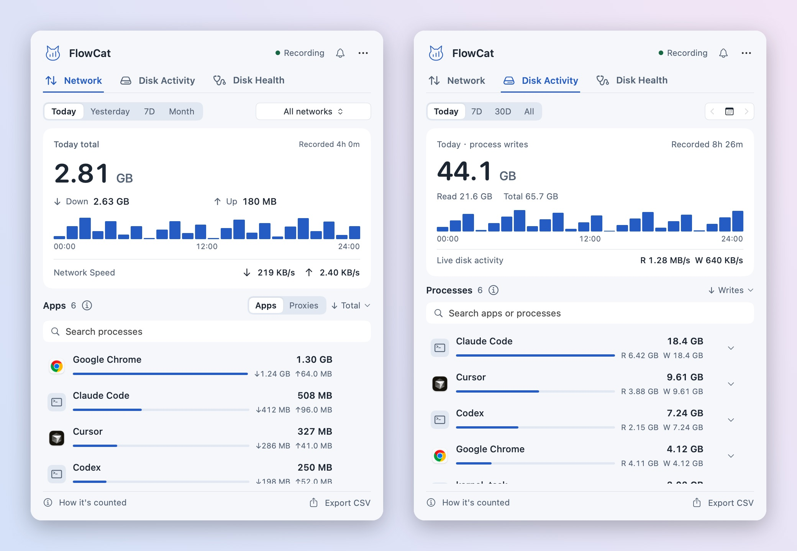
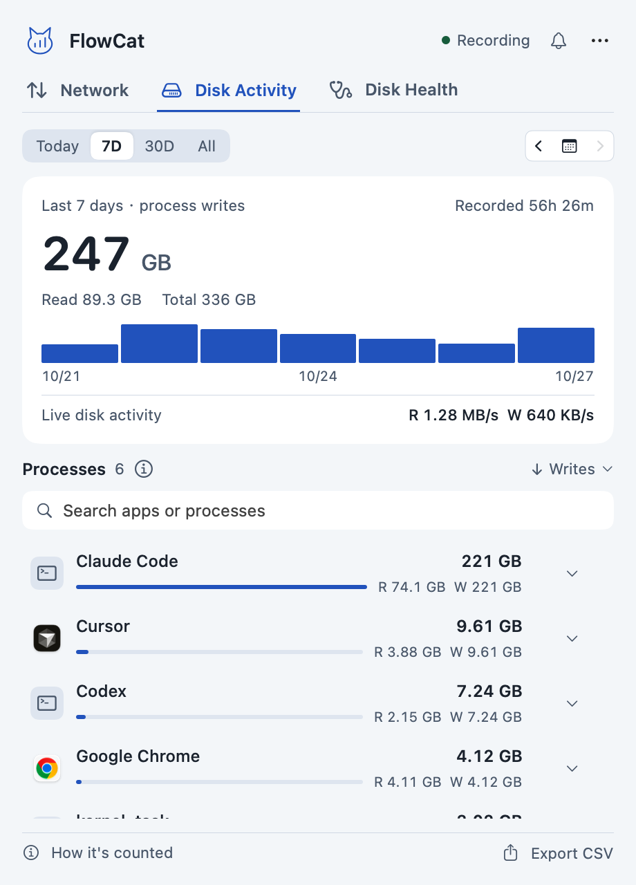
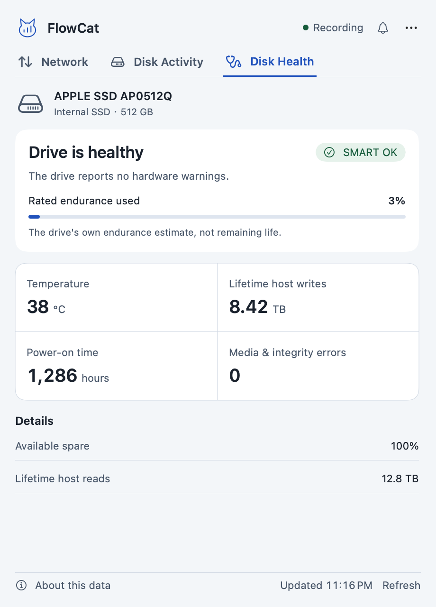
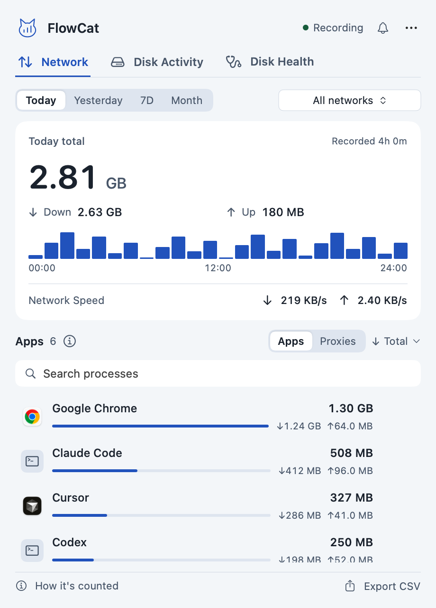

# FlowCat - Network & Disk Monitor for Mac


A native macOS menu bar app for **live network speed**, **per-process disk reads and writes**, and **SMART disk health**. Built to show which AI coding tools (Codex, Claude Code, Cursor and friends) are wearing out your SSD.

**Under 1 MB · No account · Data stays on your Mac · macOS 13+ · Apple Silicon · Apache-2.0**

[Download](https://github.com/tab16360/flowcat/releases/latest/download/FlowCat-arm64.zip) · [Website](https://tab16360.github.io/flowcat/) · [User guide](docs/guide.md) · [Changelog](CHANGELOG.md) · [Sponsor](https://github.com/sponsors/tab16360) · [简体中文](README.zh-CN.md)



*Screenshots use sample data.*

## Why FlowCat

AI agents and modern editors rebuild indexes, caches and dependencies all day. Your network meter barely moves while gigabytes land on the SSD. FlowCat ranks every process by network traffic **and** by disk writes, and puts the drive's own SMART data next to it.



## Features

| | |
| --- | --- |
| **Menu bar readout** | Today's total, network speed and disk read/write speed, each optional. The item keeps a fixed width so it doesn't jump around. |
| **Network** | Today, yesterday, last 7 days or this month, with hourly and daily charts. Filter by real Wi-Fi name. Proxies and VPNs are listed separately so relayed traffic isn't counted twice. |
| **Disk activity** | Per-process reads and writes for today, 7 days, 30 days, all time or any single day. Sort, search, expand a row for its path, step day by day. |
| **Disk health** | SMART status, temperature, lifetime host reads and writes, rated endurance used, power-on hours and media errors for internal and external drives. Read natively, no smartctl. |
| **Write alerts** | Sustained high writes, hourly and daily budgets per app, custom thresholds, pause or mute per app. Optional system notifications. |
| **Local history** | JSON on your Mac, CSV export, no account, no telemetry, never records traffic contents. |
| **Native and small** | About 740 KB download, about 2.9 MB installed. No Electron, no runtime. |
| **English and Chinese** | Follows your system language; switch in Settings. |
| **Keyboard** | ⌘1/⌘2/⌘3 switch tabs, ⌘F searches, ⌘, opens Settings, Esc closes the panel. |

<table><tr>
<td></td>
<td></td>
<td></td>
</tr></table>

## Install

1. [Download the latest ZIP](https://github.com/tab16360/flowcat/releases/latest/download/FlowCat-arm64.zip).
2. Unzip and drag the app into Applications, then open it.
3. Click the cat in the menu bar. The first 10 seconds build a baseline. Turn on **Launch at Login** in the More menu or Settings.
4. If FlowCat can't read the Wi-Fi name, macOS asks for location permission. You can decline; FlowCat then records under "All networks" and never requests your coordinates.

FlowCat is ad-hoc signed and not notarized yet. If macOS blocks the first launch, allow it under System Settings › Privacy & Security after confirming where you downloaded it. You never need to disable system protections.

**Updates:** choose **Check for Updates** in the More menu, then **Install and Relaunch**. FlowCat downloads and verifies the package, replaces itself, keeps your history and settings, and restores the previous version if anything fails. Checks only happen when you ask and only contact GitHub.

History lives in `~/Library/Application Support/流量账本/` (`ledger.json` for network, `disk-ledger.json` for disk). The folder name is kept from earlier versions so upgrades keep your data. Replacing the app never deletes it.

## Reading the numbers

**Totals** come from the physical `en*` interfaces (loopback and VPN tunnels excluded). They include LAN and protocol overhead and are not a carrier bill. Turn off **Include LAN in Totals** to subtract recognized LAN traffic; the result is labeled as an estimate.

**App rankings** come from `nettop`. Proxies and VPNs may carry traffic for other apps, so don't add ranking rows together to get the machine total.

**Disk activity** comes from per-process system counters across all disks, with app helpers merged. It is not the physical NAND writes inside the SSD. Use it to find heavy writers, and the health tab for what the drive itself reports. "Rated endurance used" is the drive's own estimate, not remaining life.

FlowCat only counts time it is running and not paused. It samples every 10 seconds and saves every minute; short-lived processes, sleep and network switches can be missed. Gray chart bars mean "not recorded", never zero.

## Build from source

Requires macOS 13+ and the Xcode Command Line Tools. No third-party dependencies.

```sh
git clone https://github.com/tab16360/flowcat.git
cd flowcat
bash scripts/test.sh
bash scripts/build.sh
open build/流量喵.app
```

The build is arm64 by default; `ARCH=x86_64 bash scripts/build.sh` tries an Intel build, which is not release-tested. `bash scripts/package.sh` creates the release ZIP and its SHA-256. `bash scripts/screenshots.sh` re-renders every screenshot, the hero image and the demo GIF in English and Chinese from sample data. The app bundle keeps its original `流量喵.app` file name so in-app updates from older versions keep working; Finder shows it as FlowCat on English systems.

```text
Sources/    SwiftUI interface, sampling, Wi-Fi detection, statistics, updater
Resources/  Localized bundle name and permission prompts
Tests/      Statistics, disk, alert and updater checks
scripts/    Build, test, package, screenshots and release
docs/       Website (English and /zh/), guides and images
```

Preview the website locally with `python3 -m http.server 8080 --directory docs` and open `http://localhost:8080`. It uses no CDN, trackers or web fonts.

## Release

CI runs the checks and builds the package. Pushes to `main` that touch `docs/` publish the website through GitHub Pages. To release, update `Info.plist`, `CHANGELOG.md` and `RELEASE_NOTES.md`, then push a matching `vX.Y.Z` tag. See the [release guide](docs/releasing.md) and [CONTRIBUTING](CONTRIBUTING.md).

## Windows

A separate Windows version (C++20 / Win32 / Direct2D) lives in [flowcat-windows](https://github.com/tab16360/flowcat-windows). This repository maintains the macOS app.

## Sponsor

FlowCat is free and built in spare time. If it helped you catch a runaway process, consider [sponsoring on GitHub](https://github.com/sponsors/tab16360). Follow [@ai_funs](https://x.com/ai_funs) for updates.

Released under the [Apache License 2.0](LICENSE).
