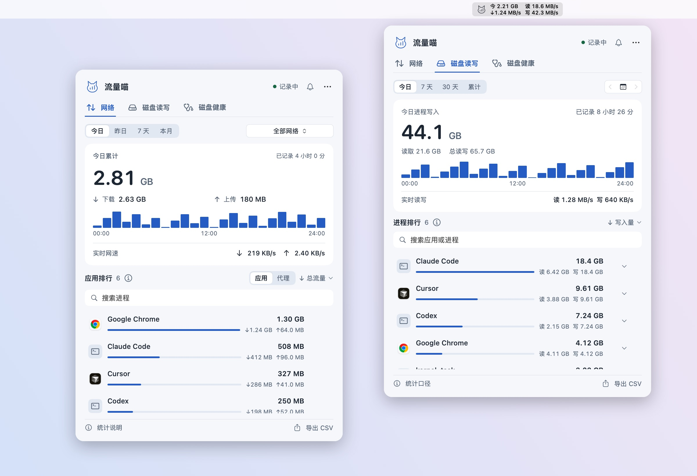
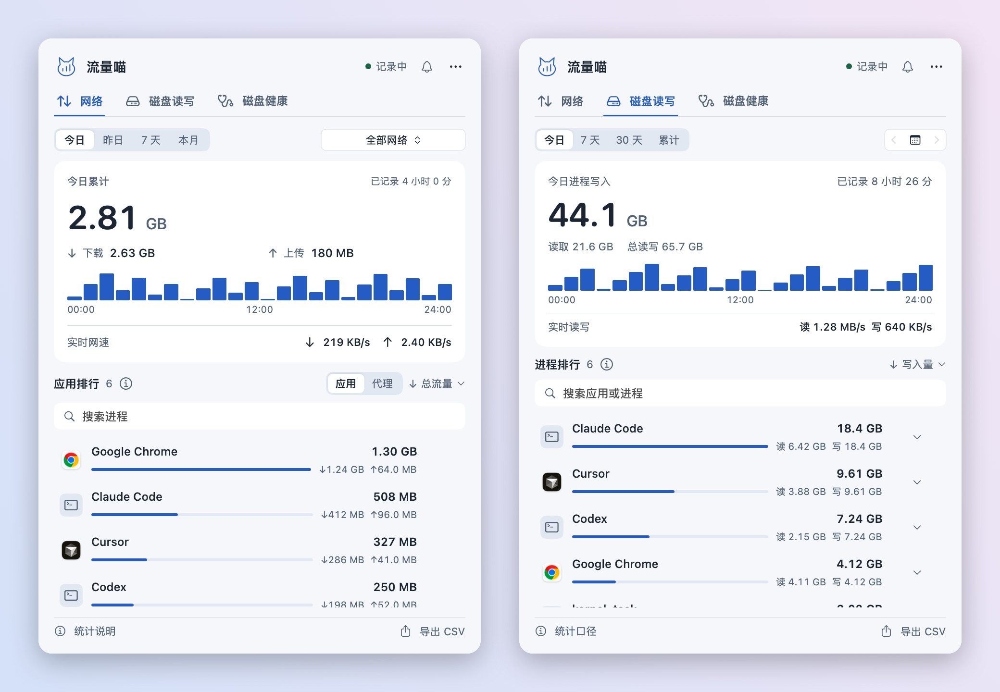
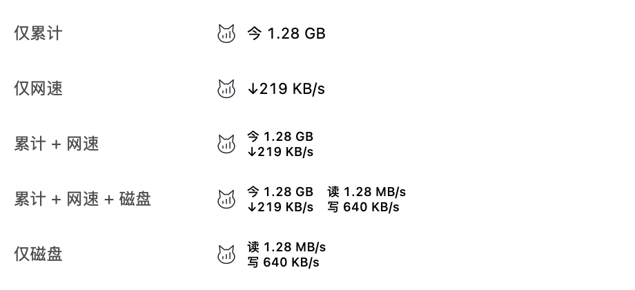
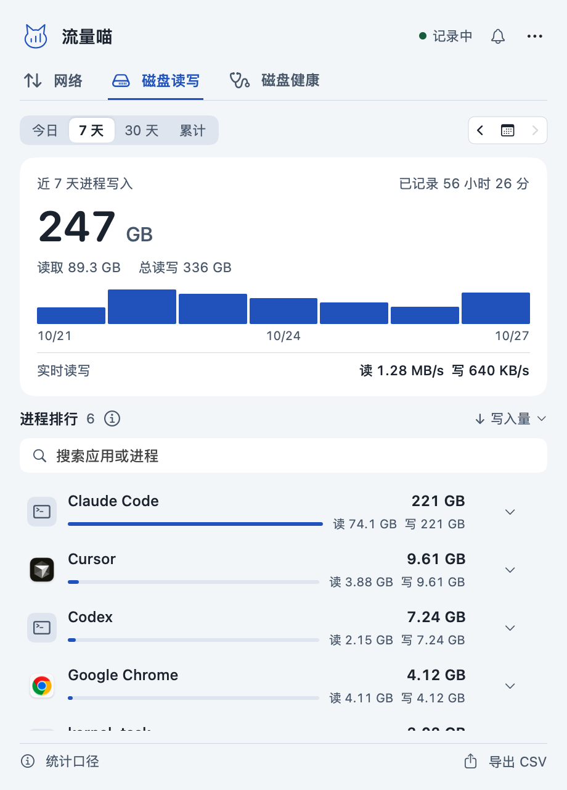
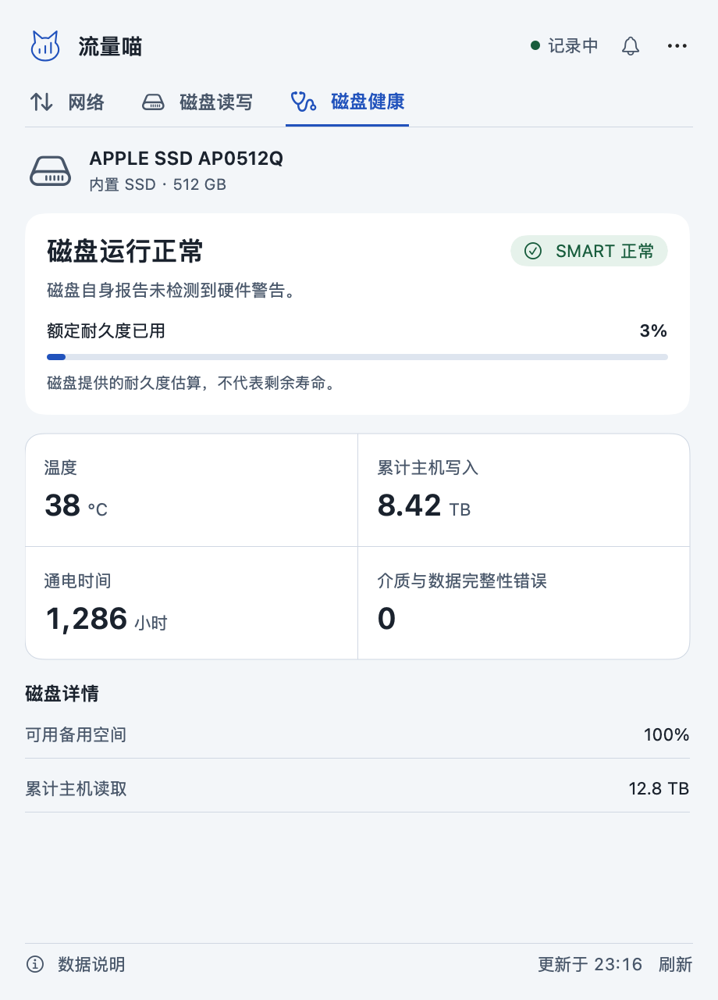

# 流量喵 FlowCat - Mac 网络与磁盘监控


原生 macOS 菜单栏监控工具：实时网速、进程磁盘读写排行、SMART 健康与温度，专门帮你看清 Codex、Claude Code、Cursor 等 AI 编程工具的写盘磨损。

**下载包不足 1 MB · 无需账号 · 数据全在本地 · macOS 13+ · Apple Silicon · Apache-2.0**

[下载最新版](https://github.com/tab16360/flowcat/releases/latest/download/FlowCat-arm64.zip) · [介绍站点](https://tab16360.github.io/flowcat/zh/) · [使用说明](docs/guide.zh-CN.md) · [更新记录](CHANGELOG.md) · [English](README.md)

关注作者 [@ai_funs](https://x.com/ai_funs)，获取流量喵更新与 AI 工具实践。



*原生界面截图，使用示例数据。*

## 能做什么

| 功能 | 说明 |
| --- | --- |
| 菜单栏显示 | 累计、网速、磁盘读写可独立勾选；累计与网速同时显示时上下排列，设置自动保存；默认图标与网速 |
| 今日／昨日／7 天／本月 | 查看各时段整机收发总量、采集覆盖时间与按小时／按日的流量趋势 |
| 应用／代理排行 | 已识别的代理、VPN 单列；合并可识别的 App 辅助进程；支持搜索与总量、下载、上传排序 |
| 包含局域网 | 总量默认包含局域网；可在“更多”菜单或设置中关闭，扣除已识别的局域网流量（估算），应用排行不受影响；开关自动保存 |
| 按 Wi-Fi 筛选 | 使用真实 SSID；不能识别或拒绝权限时仅显示全部网络 |
| 磁盘读写 | 今日、近 7 天、近 30 天、累计与按日查看；按写入、读取或总读写排序，搜索并展开进程归属 |
| 磁盘健康 | 查看内外置物理磁盘的 SMART 状态、温度、累计主机写入、耐久度已用与通电时间；缺失指标明确标注 |
| 菜单栏磁盘速度 | 独立开关显示读写速度，默认关闭，网速仍默认显示 |
| 本地记录 | JSON 持久化，可导出 CSV；无需账号、不上传数据、不记录通信内容 |
| 中英文界面 | 默认跟随系统语言，可在设置中切换 English 或简体中文 |
| 右键快捷控制 | 菜单栏图标右键或 Control 点击，打开面板、暂停／继续、菜单栏显示、登录启动、导出、设置和退出 |
| 设置与快捷键 | 菜单栏显示、局域网、登录启动与提醒集中在设置窗口（⌘,）；面板内 ⌘1／⌘2／⌘3 切换网络、磁盘读写、磁盘健康，⌘F 搜索，Esc 关闭 |
| 持续运行 | 暂停／继续、登录启动、睡眠恢复后重新建立计数基线 |



菜单栏累计按今日所有网络的上传与下载合计显示，跟随“包含局域网”开关；关闭包含局域网且无估算记录时显示“—”。右键网络或磁盘排行中的应用，或悬停后点击行尾的“⋯”，选择“打开位置”可在 Finder 定位已记录且仍存在的应用或可执行文件；路径不可用时菜单项禁用。同名进程合并时使用最近记录的可用路径。左键不跳转；点击磁盘排行的一行展开路径与详情。



磁盘写入提醒支持持续高写入、小时／每日预算、单应用阈值与暂时忽略；从面板顶部的铃铛（今日有提醒时显示圆点）、应用行的“⋯”／右键或更多菜单进入。默认关闭，系统通知按需授权，未授权仍有窗口内记录。复用已有 10 秒采样，分钟曲线仅存内存，不追踪具体文件内容。

## 小巧的原生应用

**下载包约 950 KB，解压后应用约 3.4 MB。** 无需安装 Node、浏览器内核或第三方运行环境，下载解压即可使用。安装体积不包含本地历史文件，不同构建会略有差异。

每 10 秒采样，每分钟保存；统计面板与图标按需加载。历史保存在本机，无需账号，不上传通信内容。

## 安装

网站与下载链接直接获取最新安装 ZIP。1.4.0 起，应用右键或“更多”菜单的“检查更新”可选择“安装并重启”：自动下载、校验、替换并重启，保留历史和设置，失败时恢复旧版。下载可取消；安装位置需可写。1.3.x 需先手动安装一次 1.4.0。检查由你手动触发，访问 GitHub，不发送统计记录。

1. 点击 [下载安装包](https://github.com/tab16360/flowcat/releases/latest/download/FlowCat-arm64.zip) 下载 `FlowCat-版本-arm64.zip`。
2. 解压，将 `流量喵.app` 拖入“应用程序”，双击启动。
3. 点击菜单栏图标。首次运行约 10 秒用于建立基线；“更多”菜单可设置登录启动。
4. 无法读取 Wi-Fi 名称时会请求系统定位权限。你可以拒绝，统计仍在全部网络下进行，应用不会请求位置坐标。

应用当前为临时签名、未公证。macOS 可能阻止首次打开；确认来源后按系统设置“隐私与安全性”的提示允许打开，不需要关闭系统安全功能。升级前退出旧版，再替换应用。

网络历史保存在 `~/Library/Application Support/流量账本/ledger.json`，磁盘历史另存为同目录的 `disk-ledger.json`。替换应用不会删除历史，卸载时先关闭登录启动并退出。详细说明见 [使用指南](docs/guide.zh-CN.md)。

## 怎样理解数字

**整机总量**使用 `en*` 物理网络接口计数，排除回环与 VPN 虚拟接口。包含局域网和协议开销；多网卡活动会汇总，不能替代运营商账单。

**包含局域网**开关只影响总量。关闭后，从每个采样区间的物理网卡收发字节中扣除同区间已识别的局域网连接字节，下载、上传分别归零截断后再累计。局域网识别使用物理接口的私有、链路本地及当前 IPv4/IPv6 子网；不读取或修改代理配置。短连接、协议开销与 VPN 内部传输可能无法剔除，因此是估算，不能当作精确外网用量。估算从 1.5.4 起累计，旧历史和应用进程计数不变；没有估算记录时显示“—”。

**应用／代理排行**来自 `nettop`，默认展示应用，已识别的代理和 VPN 在单独列表展示。此分类仅影响展示，不扣减或重分配历史字节。代理、VPN 可能包含其他进程转发的相同流量，因此不要把排行各行相加作为整机总量。

仅统计应用运行且未暂停的时段，不能恢复过去的流量。10 秒采样，每分钟保存；短时进程、睡眠、网络切换和计数器重置可能漏计。网络切换间隔跳过，多物理网卡同时活跃仅计入全部网络。

## 磁盘统计怎么看

在面板顶部切换到“磁盘”。读写量来自进程系统计数器的增量，默认按写入量排行；应用与辅助进程合并，历史保留已退出进程的已采集记录。进程统计覆盖所有磁盘，不提供无法可靠归属的分盘排行。7 天、30 天包含今日；累计自开始监控起算。

磁盘健康按物理磁盘查看，原生读取系统与 IOKit 提供的 SMART 信息，无需安装 smartctl。耐久度已用不等于剩余寿命，进程写入也不等于 SSD 闪存实际写入。部分系统进程受权限限制，短暂进程可能漏采；外置硬盘盒可能不提供健康信息。健康信息按需读取，之后约每 10 分钟刷新，也可手动刷新；不进行磁盘自检或修改硬件设置。

<table><tr><td></td><td></td></tr></table>

*原生界面截图使用示例数据。真实可读指标取决于硬件、连接与系统权限。*

## 从源码构建

需要 macOS 13+ 和 Xcode Command Line Tools，不需要 Node、pnpm 或第三方库。

```sh
git clone https://github.com/tab16360/flowcat.git
cd flowcat
bash scripts/test.sh
bash scripts/build.sh
open build/流量喵.app
```

构建默认 arm64；可使用 `ARCH=x86_64 bash scripts/build.sh` 尝试 Intel 构建，当前未进行 Intel 运行验收。创建发布包：

```sh
bash scripts/package.sh
# 输出 dist/FlowCat-1.7.0-arm64.zip 及其 SHA-256
```

应用图标与菜单栏猫咪共用 `Sources/BrandIcon.swift` 中的矢量造型。修改后运行 `bash scripts/icons.sh` 重新生成应用图标及站点预览。

## 项目结构

```text
Sources/       SwiftUI 界面、采样、SSID 识别与统计核心
Tests/         核心统计回归检查
scripts/       构建、检查、打包和发布
Info.plist     应用身份、版本与权限说明
docs/          静态介绍站点、图示与使用指南
.github/       CI、GitHub Pages 与 tag Release 工作流
```

本地预览介绍页：`python3 -m http.server 8080 --directory docs`，访问 `http://localhost:8080`。页面不使用第三方 CDN、跟踪器或外部字体。

## 发布与维护

CI 检查核心统计并生成安装包。`main` 上的站点更新由 GitHub Pages 工作流发布。发布前更新 `Info.plist`、`CHANGELOG.md` 和 `RELEASE_NOTES.md`，然后推送与版本一致的 `vX.Y.Z` 标签；Release 工作流验证、打包并上传 ZIP 与校验文件。

完整发布步骤见 [发布指南](docs/releasing.md)，参与开发见 [CONTRIBUTING](CONTRIBUTING.md)。

## 验证状态

1.7.0 已通过本机构建、签名，以及核心统计、磁盘持久化、写入提醒、更新器集成与真实安装包替换检查；中英文、浅色、深色、窄屏和短屏界面均已渲染核对，设置窗口与面板交互经人工试用。权限弹窗和多显示器场景尚未系统验收。

## Windows 版

Windows 版已迁入独立仓库：[flowcat-windows](https://github.com/tab16360/flowcat-windows)。使用 C++20 / Win32 / Direct2D，后台采集服务与普通权限托盘界面分离，提供独立安装器、Wi-Fi 筛选、设置与更新渠道。

[Windows 介绍与下载](https://tab16360.github.io/flowcat/windows/)。本仓库继续维护 macOS 版。

采用 [Apache License 2.0](LICENSE) 许可证。
